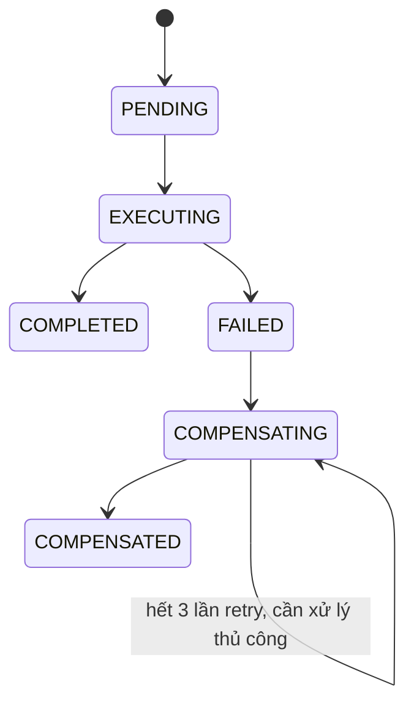
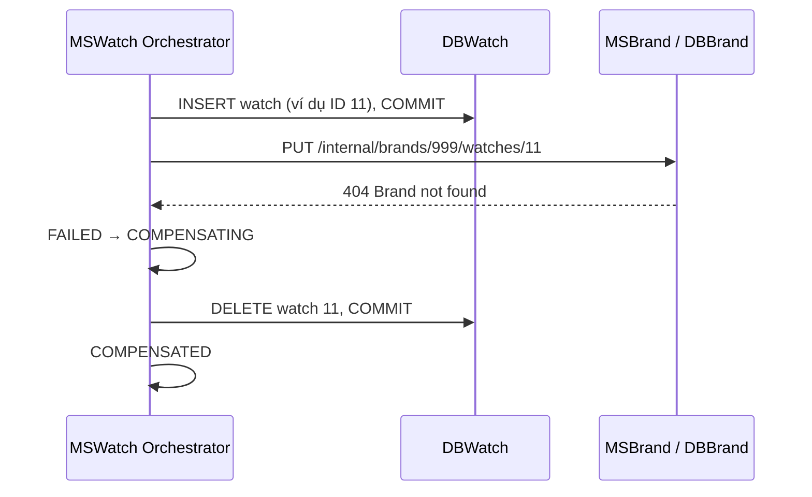

# Saga design — Watch Management

DE190468 — Lê Ngọc Minh Kiên. Refs: TODO-4.1, TODO-4.2.

Tài liệu thiết kế cho toàn bộ Saga; phạm vi triển khai hiện tại dừng ở TODO5.
Orchestrator, fault injection và nhật ký dưới đây sẽ được code ở TODO6.
Thiết kế đã được đối chiếu với đề; việc giảng viên duyệt là bước học vụ cần
sinh viên thực hiện, không được ghi nhận là đã duyệt trong báo cáo này.

## Quyền sở hữu dữ liệu

| Service | Vai trò | Database và dữ liệu |
|---|---|---|
| MSAccount | Identity provider | DBAccount.StoreAccounts |
| MSBrand | Saga participant | DBBrand.WatchBrands, BrandWatches |
| MSWatch | Orchestrator | DBWatch.Watches, WatchCategories, SagaStates, SagaLogs |
| Gateway | Xác thực và routing | Không truy cập database |

BrandID trong DBWatch là tham chiếu logic qua API, không phải FK xuyên DB.
BrandWatches.WatchID là UNIQUE; dữ liệu gán thương hiệu chỉ do MSBrand thay đổi.

## CREATE_WATCH

| Thứ tự | Local transaction | Owner | Compensation | Idempotent |
|---|---|---|---|---|
| 1 | CREATE_WATCH: insert và commit watch | MSWatch/DBWatch | DELETE_WATCH theo ID vừa tạo | Có: deleteIfExists |
| 2 | ASSIGN_BRAND: upsert watch → brand | MSBrand/DBBrand | UNASSIGN_BRAND | Có: gỡ lần hai trả NOTHING_TO_DO |

## UPDATE_WATCH

| Thứ tự | Local transaction | Owner | Compensation | Idempotent |
|---|---|---|---|---|
| 1 | UPDATE_WATCH: ghi dữ liệu mới | MSWatch/DBWatch | RESTORE_WATCH bằng snapshot before | Có: ghi lại cùng toàn bộ giá trị cũ |
| 2 | ASSIGN_BRAND: chuyển sang brand mới | MSBrand/DBBrand | ASSIGN_BRAND_BACK về brand cũ | Có: upsert cùng WatchID/BrandID |

Snapshot `before` lấy trước khi sửa: ID, tên, CategoryID, BrandID, vật liệu,
waterResistance, giá, releaseDate và stock. Không chỉ giữ reference tới entity
managed vì entity đó có thể đã bị thay đổi. Compensation không sinh WatchID mới.

## DELETE_WATCH

| Thứ tự | Local transaction | Owner | Compensation | Idempotent |
|---|---|---|---|---|
| 1 | UNASSIGN_BRAND | MSBrand/DBBrand | ASSIGN_BRAND_BACK về brand cũ từ snapshot | Có: upsert |
| 2 | DELETE_WATCH: xoá cứng | MSWatch/DBWatch | Không có — **PIVOT** | Không chạy compensation sau pivot |

Xoá cứng IDENTITY không thể phục hồi cùng ID bằng insert thông thường. Vì vậy
bước này đứng cuối, sau thao tác mạng có thể thất bại. Sau khi pivot commit,
không cố giả lập lỗi và không chạy compensation của bước trước; ghi nhận fault
injection sau pivot là SKIPPED và hoàn thành Saga.

## Máy trạng thái và nhật ký

- Chỉ push bước đã commit thành công vào stack, compensation chạy LIFO.
- Retry tối đa 3 lần cho mỗi compensation, backoff 1 giây. Hết lượt thì dừng
  COMPENSATING; không được báo COMPENSATED hoặc tiếp tục che giấu lỗi.
- SagaTracker dùng REQUIRES_NEW để trạng thái/log không mất theo transaction
  nghiệp vụ thất bại. Ghi rõ EXECUTE, COMPENSATE, FAULT và lỗi của từng bước.
- Validate name >10 ký tự, price >=100, đủ field, ngày hiện tại và category
  trước khi tạo SagaStates. Kiểm tra brand bằng bước ghi participant, không
  chỉ gọi exists rồi coi đó là distributed transaction.

## Thất bại CREATE với brand 999

DBWatch đã commit INSERT nên IDENTITY có thể nhảy cóc sau compensation.
Đây là bù trừ bằng transaction mới, không phải rollback INSERT cũ.

## Vì sao không dùng một @Transactional hoặc 2PC

`@Transactional` chỉ kiểm soát một transaction manager/database; HTTP đến
MSBrand không tham gia transaction DBWatch. Bọc cả orchestrator còn giữ
connection/lock trong lúc đợi mạng và có thể làm rollback mất nhật ký Saga.
Mỗi local step của MSBrand vẫn cần @Transactional trong DBBrand.

2PC cần coordinator và distributed lock xuyên nhiều service, khiến dữ liệu
bị giữ lâu khi mạng hoặc participant lỗi. Saga cho phép commit cục bộ, đạt
eventual consistency bằng compensation và lưu trạng thái cần khôi phục rõ ràng.

## Giới hạn và vận hành

PUT gán lặp cùng ID giữ một dòng; DELETE lặp không lỗi. PUT đổi brand là
upsert lên chính dòng cũ. Không thiết lập FK từ BrandWatches sang DBWatch.
Unique constraint bảo vệ WatchID; transaction participant tuần tự hoá thao tác
trên cùng watch khi có request đồng thời.

Service nội bộ chỉ mở trong mạng tin cậy. TODO7 sẽ không route `/internal/**`
và sẽ xoá X-User-* do client gửi, verify JWT rồi áp quyền Admin. Chưa có bảo vệ
gateway trong phạm vi TODO5; không công bố trực tiếp cổng service ra Internet.

Nếu HTTP timeout sau khi participant đã commit nhưng orchestrator chưa nhận
response, kết quả có thể không chắc chắn. Các endpoint idempotent cho phép
retry để xác định trạng thái; phần recovery bền vững/outbox cần thiết kế bổ sung
trước khi triển khai production, không được coi timeout là đã rollback ở MSBrand.
